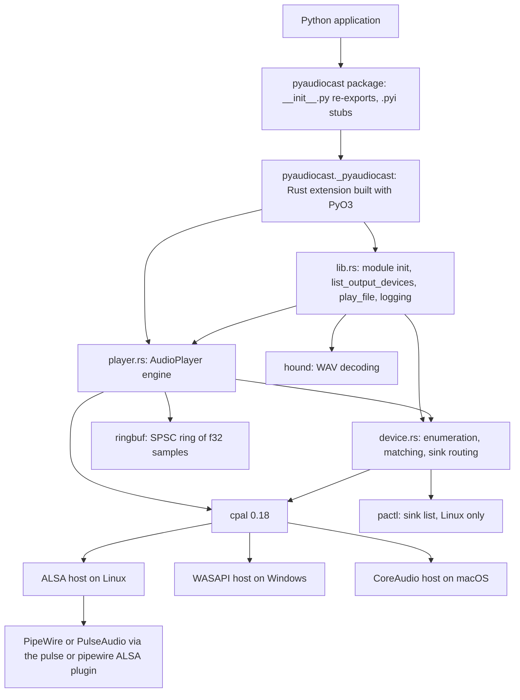
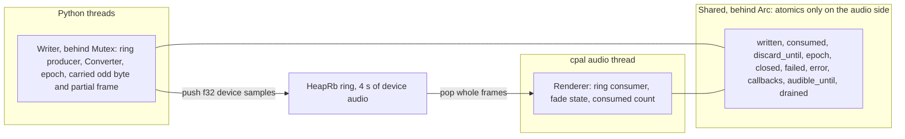
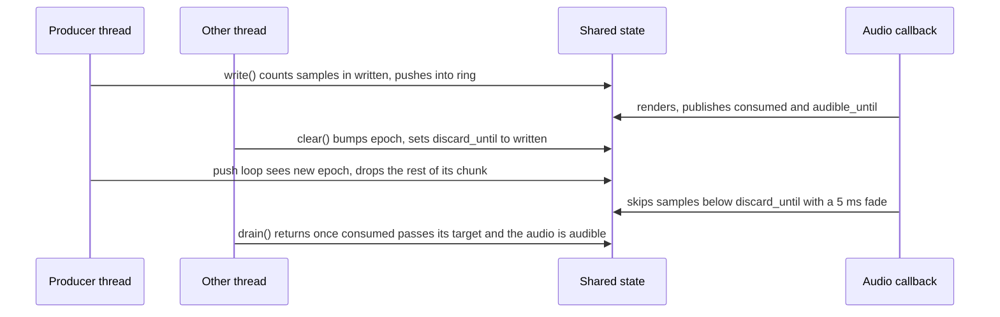

# Architecture Overview

PyAudioCast is a cross-platform audio **output** library for Python. Its core
job is streaming audio that is produced incrementally (text-to-speech,
generated audio) to a speaker or a PipeWire/PulseAudio sink, and being able to
cut that audio off instantly from another thread ("barge-in"). A Python
package fronts a Rust extension that does all the work on top of
[cpal](https://github.com/RustAudio/cpal).

## Layers

| Layer | Source | Responsibility |
|---|---|---|
| Python package | `pyaudiocast/__init__.py`, `_pyaudiocast.pyi`, `py.typed` | Re-exports `AudioPlayer`, `list_output_devices`, `play_file`, `__version__`; ships type stubs. No logic. |
| Module entry | `src/lib.rs` | Registers the module, implements `list_output_devices` and the `play_file` workflow, initializes logging. |
| Devices | `src/device.rs` | Picks the cpal host, lists devices plus PipeWire/PulseAudio sinks, resolves a `device=` query to an `OutputTarget`, routes sinks through an environment variable, and serializes all of this with one global lock. |
| Playback engine | `src/player.rs` | `AudioPlayer`: stream setup and config negotiation, input extraction, alignment, resampling and channel mapping, the ring buffer, the realtime renderer, and the clear/stop/drain protocol. |
| Errors | `src/error.rs` | `SpeakerError` and its conversion to Python `RuntimeError`. |

cpal is used without any optional host features, so on Linux the only host is
ALSA: PipeWire and PulseAudio are reached through ALSA's `pulse`/`pipewire`
plugin devices, never through a native PipeWire host. How the Rust crate is
exposed to Python (GIL policy, error mapping) is described in
[Native Extension Boundary](native-extension-boundary.md).

## Threads: who runs what

| Thread | Runs | Constraints |
|---|---|---|
| Python caller threads | `AudioPlayer(...)`, `write()`, `drain()`, `clear()`, `stop()`, `play_file()`, `list_output_devices()` | Blocking phases release the GIL; waits poll every 5 ms and run signal handlers every 100 ms. Typical use: one producer thread writes, any other thread may `clear()`. |
| cpal audio callback (OS audio thread) | `Renderer::render` inside the data callback: copy samples from the ring, skip discarded audio, convert to the device's sample type | Lock-free and allocation-free: touches only the ring consumer it owns and the atomics in `Shared`. |
| cpal error callback | Classifies stream errors: ignore, warn, throttle, or latch a fatal failure | May sleep 50 ms to throttle cpal's retry loop when a server has dropped the stream. |
| Python main thread, inside a blocked call | Signal handlers (Ctrl+C, user handlers) run during the periodic signal check | Handlers may re-enter the player (`stop()`, `write()`); the writer lock is never held across a wait. |

## Who owns which state

- **`Shared`** (`Arc`, shared with the callback) holds monotonic sample
  counters, the epoch, the closed/failed flags with the first failure message,
  and timing data. The callback side only uses atomics.
- **`Writer`** (`Mutex`, Python threads only) owns the ring *producer*, the
  `Converter` (resampler state), and the half-sample / partial-frame leftovers
  of unaligned writes.
- **`Renderer`** is moved into the cpal data callback and owns the ring
  *consumer*; it publishes how much it consumed into `Shared.consumed`.
- **`stream`** (`Mutex<Option<cpal::Stream>>`): `stop()` takes and drops it,
  which ends playback. The `Writer` and its ring live until the Python object
  is dropped.
- **`OPEN`** (a static mutex in `device.rs`): held for every device lookup and
  stream open, because sink routing temporarily changes the process
  environment that alsa-lib and libpulse read.

### Two formats, one vocabulary

The **caller format** is what `write()` accepts: `sample_rate` × `channels`.
The **device format** is what the stream runs at: `device_sample_rate` ×
`device_channels`, plus a device sample type (f32, i16, i24, …). Conversion
from caller to device format happens on the Python thread in `write()`; the
ring holds interleaved **f32 samples in device format**, and the counters
`written`, `consumed` and `discard_until` count those samples — not frames.

## Data path: from `write()` to the speaker

1. **Extract (GIL held).** `write()` records the current epoch, fails fast if
   the player is closed or failed, and copies the input into either int16 PCM
   bytes or f32 samples. → [Write Path and Input Formats](../playback/write-path-and-input-formats.md)
2. **Align and convert (GIL released).** Under the writer lock it starts a new
   stream if needed, completes a sample or frame left over by the previous
   write, and converts caller format to device format.
   → [Resampling and Channel Mapping](../playback/resampling-and-channel-mapping.md)
3. **Push.** Samples go into the ring in as many steps as space allows; each
   step counts the samples in `written` *before* publishing them, and the loop
   waits 5 ms between steps while the ring is full.
4. **Render (audio thread).** Each callback takes whole frames from the ring,
   fades out and skips anything below the discard watermark, converts to the
   device sample type, pads with silence, and records `consumed` and when the
   last sample will be audible.
   → [Audio Callback and Rendering](../playback/audio-callback-and-rendering.md)

## Control paths

- **`clear()`** bumps the epoch and raises the discard watermark to everything
  written so far; in-flight writes stop pushing, the callback skips the stale
  audio (fading out what was playing), and a pending `drain()` returns.
- **`stop()`** sets `closed`, performs a clear, and drops the stream; later
  writes fail with `Player is closed`.
- **`drain()`** snapshots `written` and waits until the callback has consumed
  that much *and* the device latency has elapsed; audio written afterwards
  does not extend the wait.
- **Failures** reported by cpal, or a callback that stops arriving for 5 s
  while someone waits, are latched into `Shared`; the next `write()`/`drain()`
  raises `RuntimeError` and `is_active` turns `False`.

The precise protocol — including the race between `clear()` and a concurrent
push — is in [Interruption, Drain and Stop Semantics](../playback/interruption-and-drain.md);
waiting and failure handling are in
[Blocking Waits and Stream Failure Handling](../playback/blocking-waits-and-stream-failures.md).

## Setup path and platform differences

`AudioPlayer(...)` validates its arguments, resolves the device
([Device Discovery and Selection](../devices/device-discovery-and-selection.md)),
and opens a stream ([Stream Setup and Config Negotiation](../playback/stream-setup-and-negotiation.md)):

- **Linux:** devices come from the ALSA host; sinks found with `pactl` are
  opened through the `pulse` or `pipewire` ALSA device with `PULSE_SINK` /
  `PIPEWIRE_NODE` set during the open
  ([Sink Routing](../devices/pipewire-sink-routing.md)).
- **macOS:** the stream always opens at the device's current default rate and
  channel count (changing them would affect every app), and the converter
  adapts the caller's audio.
- **Windows:** WASAPI devices only; no sink support.

`play_file` reuses this whole engine: it opens a player at the WAV file's
format and streams decoded chunks through the same push and drain path
([WAV File Playback](../playback/wav-file-playback.md)).

## Related pages

- [Native Extension Boundary (PyO3)](native-extension-boundary.md)
- [Stream Setup and Config Negotiation](../playback/stream-setup-and-negotiation.md)
- [Write Path and Input Formats](../playback/write-path-and-input-formats.md)
- [Audio Callback and Rendering](../playback/audio-callback-and-rendering.md)
- [Interruption, Drain and Stop Semantics](../playback/interruption-and-drain.md)
- [Device Discovery and Selection](../devices/device-discovery-and-selection.md)
