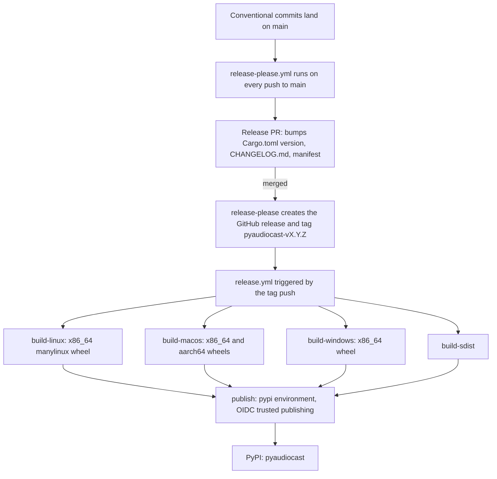

# Release Process

Releases are fully automated from `main`: release-please turns conventional
commits into a release PR, merging that PR creates a tag, and the tag triggers
the wheel builds and the PyPI upload.

## Versioning rules

`release-please-config.json` defines a single package at the repository root
with `release-type: rust`, so the version that gets bumped is the one in
`Cargo.toml` — the project's only version source (see
[Build and Packaging](build-and-packaging.md#version-one-source-of-truth)).
`.release-please-manifest.json` records the last released version (`0.2.0`).

While the version is below 1.0:

| Commit type | Bump | Example from `CHANGELOG.md` |
|---|---|---|
| `fix:` | patch | 0.1.9 → 0.1.10 |
| `feat:` | **patch** (`bump-patch-for-minor-pre-major`) | 0.1.7 → 0.1.8 for "auto-negotiate device config" |
| `feat!:` / `BREAKING CHANGE:` | **minor** (`bump-minor-pre-major`) | 0.1.10 → 0.2.0 |

Tags (and GitHub releases) are named `pyaudiocast-v<version>`, as the
changelog's compare links show; that prefix is exactly what the release
workflow listens for. The release PR title has the form
`chore(main): release pyaudiocast X.Y.Z`.

## `release-please.yml`

Runs `googleapis/release-please-action@v5` on every push to `main`, with
`contents: write` and `pull-requests: write`. It authenticates with the
`RELEASE_PLEASE_TOKEN` secret instead of the default `GITHUB_TOKEN`: tags
pushed with `GITHUB_TOKEN` do not start other workflows, and the release
workflow is triggered by the tag push (it was moved from the `release` event to
tag pushes early on). Without that token, merging a release PR would create a
tag but never build or publish anything.

## `release.yml`

Triggered by pushing a tag that matches `pyaudiocast-v*`. Default token
permissions are `contents: read`.

| Job | Runner | Output | Notes |
|---|---|---|---|
| `build-linux` | `ubuntu-latest` | `wheels-linux-x86_64` | `maturin-action` with `--release --out dist-pre --auditwheel skip -i python3.12`, `manylinux: auto`, and `yum install -y alsa-lib-devel` in the manylinux container; then `auditwheel repair --exclude libasound.so.2` into `dist/`. |
| `build-macos` | `macos-latest` | `wheels-macos-x86_64`, `wheels-macos-aarch64` | Targets `x86_64-apple-darwin` and `aarch64-apple-darwin`, Python 3.12. |
| `build-windows` | `windows-latest` | `wheels-windows-x86_64` | Python 3.12. |
| `build-sdist` | `ubuntu-latest` | `wheels-sdist` | `maturin sdist`. |
| `publish` | `ubuntu-latest` | PyPI upload | Needs all four build jobs. Runs in the `pypi` environment with `id-token: write`, downloads every `wheels-*` artifact into `dist/`, and uploads with `pypa/gh-action-pypi-publish@release/v1`. |

Details that matter when changing this workflow:

- **One interpreter per wheel is enough.** The crate is built with PyO3's
  `abi3-py39`, so a wheel built with Python 3.12 is tagged for the stable ABI
  and installs on every CPython ≥ 3.9.
- **Why auditwheel runs separately on Linux.** maturin's bundled auditwheel
  would vendor `libasound.so.2` into the wheel. The separate repair step
  excludes it, so the wheel uses the system's ALSA library and therefore the
  system's PipeWire/PulseAudio ALSA plugins — which is also why Linux users
  must have `libasound.so.2` installed.
- **No Linux aarch64 wheel.** It was removed because ALSA cross-compilation
  was unsupported.
- **Trusted publishing.** No PyPI API token is passed; the publish action
  authenticates through the job's OIDC identity, which PyPI must be configured
  to trust for this repository and environment. Any protection rules on the
  `pypi` environment live in the repository settings, not in the repository.
- **No tests run here.** The release workflow only builds and uploads; CI on
  `main` is the quality gate ([Continuous Integration](continuous-integration.md)).
  Conversely, pull-request CI never runs these build jobs, so changes to
  packaging or to this workflow should be verified before a release is tagged.

## Cutting a release

1. Merge work into `main` with conventional-commit messages (squash-merged PR
   titles such as `feat!: …` or `fix: …`).
2. Wait for release-please to open or update the release PR; check the version
   bump and the generated `CHANGELOG.md` entry. A breaking change should carry
   a `BREAKING CHANGE` description, which becomes the "⚠ BREAKING CHANGES"
   section.
3. Merge the release PR. release-please tags `pyaudiocast-vX.Y.Z` and creates
   the GitHub release.
4. `release.yml` builds all wheels and the sdist and publishes them to PyPI
   once every build succeeds (and once any environment approval is granted).

Do not hand-edit the version in `Cargo.toml`, `CHANGELOG.md` or
`.release-please-manifest.json` outside a release PR; release-please owns them.

## Related pages

- [Build and Packaging](build-and-packaging.md)
- [Continuous Integration](continuous-integration.md)
