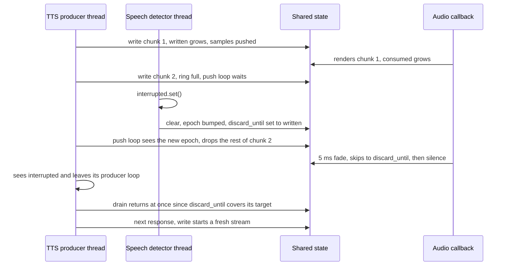

# Interruption, Drain and Stop Semantics

`AudioPlayer` lets one thread stream audio while any other thread interrupts
it. No lock is shared with the audio callback; instead a handful of atomics in
`Shared` (`src/player.rs`) form a small protocol. This page explains that
protocol. The realtime half is in
[Audio Callback and Rendering](audio-callback-and-rendering.md), waiting and
failures are in
[Blocking Waits and Stream Failure Handling](blocking-waits-and-stream-failures.md).

## The shared state

| Field | Meaning | Written by |
|---|---|---|
| `written` | Samples ever counted into the ring | `push()`, **before** publishing them |
| `consumed` | Samples ever taken out of the ring (played, faded or discarded) | audio callback |
| `discard_until` | Watermark: the callback discards samples until `consumed` reaches it | `clear()`, and `push()` when it races a clear |
| `epoch` | Bumped by every `clear()` (and so by `stop()`) | `clear()` |
| `closed` | Set by `stop()` | `stop()` |
| `drained` | `written` at the moment a `drain()` saw everything play out; `u64::MAX` once any write has happened since | `drain()`, `push()` |
| `audible_until` | When the last audio handed to the device will have been heard | audio callback |

All counters are monotonic `u64`s counting **interleaved device-format
samples**, not frames, and never reset. `discard_until` only grows
(`fetch_max`) and never exceeds `written`. Because the counters are absolute,
"discard everything written so far" is a single number — nothing has to be
flushed out of the ring.

## `clear()`

```rust
fn clear(&self) {
    // SeqCst pairs with push(): either we see its samples in `written`, or it sees our epoch.
    self.epoch.fetch_add(1, Ordering::SeqCst);
    self.discard_until.fetch_max(self.written.load(Ordering::SeqCst), Ordering::SeqCst);
}
```

Two atomic operations, no lock, no GIL release, no allocation: `clear()` never
blocks and never raises, so it is safe from any thread or a signal handler.
Its effects:

- **Queued audio is skipped.** The callback discards everything below the new
  watermark, fading out over 5 ms if audio was playing.
- **In-flight writes stop.** Every `write()` compares the epoch it captured at
  entry with the current one before each push step; on a mismatch it returns,
  dropping the rest of its data.
- **A pending `drain()` returns** (it watches the epoch too).
- **The stream ends.** The next `write()` resets carried alignment and
  resampler state (see [Streams](#when-a-stream-ends-and-restarts)).

`clear()` cannot recall audio the callback already handed to the device: the
contents of the device's current buffer and its output latency still play out.

### Racing a concurrent `push()`

A writer may be in the middle of a push step when `clear()` runs. Each step
does:

```rust
let n = w.producer.vacant_len().min(samples.len() - offset);
// Count samples before publishing them: a racing clear() either covers them,
// or we see its epoch and cover them, before the callback can see them.
let end = shared.written.fetch_add(n as u64, Ordering::SeqCst) + n as u64;
if shared.epoch.load(Ordering::SeqCst) != epoch {
    shared.discard_until.fetch_max(end, Ordering::SeqCst);
}
w.producer.push_slice(&samples[offset..offset + n]);   // publish
```

All four operations involved — the step's `written.fetch_add` and
`epoch.load`, the clear's `epoch.fetch_add` and `written.load` — are
`SeqCst`, so they fall into one total order. Either the clear's read of
`written` comes after the step's increment, so the clear's watermark covers
the step's samples; or it comes before, in which case the clear's epoch bump
precedes the step's epoch read, the step sees the new epoch and raises the
watermark to `end` itself — *before* `push_slice` publishes the samples. A
step that sees neither was logically before the clear, and its samples are
simply part of what the clear discards. The step after that sees the new epoch
at its top and returns.

### Why the renderer reads the ring first

On its side, the callback takes its snapshot of the queued samples *before*
loading `discard_until`. Seeing samples published by `push_slice` means
everything the pushing thread did earlier — including its `fetch_max` of the
watermark — is visible, so stale samples cannot slip past a stale watermark.
Reading the watermark first would allow exactly that. Should the watermark
run ahead of the queue (the clear counted samples not yet published), the
callback keeps discarding them as they arrive.

### Input caught mid-extraction

`write()` captures the epoch **at entry**, before checking the player and
before extracting samples from the Python object. If a `clear()` lands while
the input is still being extracted (another thread can run whenever extraction
calls back into Python, e.g. a list element's `__float__`), the push sees the
mismatch and drops the whole input.

## `stop()`

```rust
self.shared.closed.store(true, Ordering::SeqCst);
self.shared.clear();
py.detach(|| drop(lock(&self.stream).take()));
```

`stop()` marks the player closed, performs a `clear()`, and drops the cpal
stream with the GIL released. A `write()` blocked in another thread notices
the new epoch within one 5 ms poll and raises
`RuntimeError: Stream error: Player is closed`; later writes raise the same at
entry. A blocked or later `drain()` returns immediately without error.
`stop()` is idempotent, and is what the context manager's `__exit__` calls.

## `drain()`

`drain()` snapshots `target = written` and the epoch, then waits (GIL
released, polling every 5 ms) until one of:

1. **Interrupted:** the epoch changed, the player is closed, or
   `discard_until ≥ target` (everything up to the target was discarded). It
   returns `Ok` at once. This also covers a player that was never written to
   (`0 ≥ 0`) and a `drain()` right after `clear()`.
2. **Played:** the callback has consumed the target (`consumed ≥ target`). At
   that moment `drain()` reads `audible_until` once, and finishes when the
   clock passes it — i.e. after the device's output latency, so a `stop()`
   right after `drain()` does not cut off the tail. It then stores
   `drained = target`.
3. **Failed:** `check()` raises if the stream has failed (or the waiter
   detects a stall, or a signal handler raises).

Two consequences of the snapshot:

- **Later writes don't extend the wait.** `target` is fixed at entry, and
  `audible_until` is captured once — later callbacks pushing it further for
  newer audio do not move the finish line. A producer can keep writing while
  another thread drains.
- **Latency is bounded.** The latency part of `audible_until` is capped at
  1 s, so a bogus latency report delays `drain()` by at most a second.

## When a stream ends and restarts

Consecutive writes form a **stream**: a sample split across two writes (odd
byte of int16 PCM), a frame split across two writes, and the resampler's
history all carry over from one `write()` to the next
([Write Path](write-path-and-input-formats.md),
[Resampling](resampling-and-channel-mapping.md)). A stream ends when:

| Event | Detected by the next `write()` as |
|---|---|
| `clear()` or `stop()` | the writer's stored epoch differs from the write's epoch |
| a `drain()` that saw everything play out, with nothing written since | `drained.swap(u64::MAX) == written` |

On either, `Writer::begin` resets the converter and drops any carried odd byte
or partial frame (logging a warning if a drained stream ended mid-sample or
mid-frame). Carrying that remainder into unrelated audio would shift every
following sample by a byte or rotate the channels, and resampler history would
bleed the old audio into the new.

A `drain()` that returned early (cleared or stopped) does not set `drained`,
and any write swaps `drained` back to `u64::MAX`; so a drain that completes
while other writes have already moved `written` past its target does not end
the stream those writes belong to.

## Barge-in

The flagship pattern: a TTS thread streams a response; a speech detector
interrupts it as soon as the user talks.



```python
interrupted = threading.Event()

def speak(chunks):                    # producer thread
    interrupted.clear()
    for chunk in chunks:
        if interrupted.is_set():
            break
        player.write(chunk)           # blocks while the ring is full
    player.drain()

def on_user_speech():                 # any other thread
    interrupted.set()                 # 1. stop producing this response
    player.clear()                    # 2. silence what is already buffered
```

Both steps are needed. `clear()` only affects writes already in flight; a
`write()` that *starts* after the clear captures the new epoch and plays
normally — so a producer loop that keeps going would play the rest of the
interrupted response. `examples/stream_with_interrupt.py` demonstrates the
pattern with a timer thread.

## Tests that pin the protocol down

| Test | Regression it guards |
|---|---|
| `test_barge_in_does_not_replay_interrupted_audio` | A writer blocked on a full ring kept pushing its stale chunk after `clear()`. |
| `test_clear_then_write_drops_old_audio` | `write()` right after `clear()` resurrected the cleared audio. |
| `test_empty_write_after_clear_keeps_audio_cleared` | An empty write after `clear()` must not bring audio back. |
| `test_clear_from_another_thread` | `clear()` from another thread raised `PanicException` (the class used to be thread-bound). |
| `test_clear_unblocks_drain_in_another_thread`, `test_clear_then_drain_returns_immediately` | `drain()` returns promptly after `clear()`. |
| `test_stop_unblocks_writer_in_another_thread` | A writer blocked on a full ring is released by `stop()` with "closed". |
| `test_drain_after_stop_returns` | `drain()` hung forever after `stop()` with audio buffered. |
| `test_drain_ignores_audio_written_after_it` | `drain()` waited until the stream went idle, i.e. for later writes too. |
| `test_drain_waits_for_buffered_audio` | `drain()` returned immediately when the callback ran while `write()` was still converting. |
| `writes_need_not_hold_whole_samples_or_frames`, `a_drained_stream_cut_mid_sample_does_not_misalign_the_next` (Rust) | Carry-over within a stream, reset on a new epoch or after a completed drain. |

Most Python tests are timing-based; see
[Audio Test Environments](../testing/audio-test-environments.md) for why they
warm the device up first.

## Related pages

- [Audio Callback and Rendering](audio-callback-and-rendering.md)
- [Write Path and Input Formats](write-path-and-input-formats.md)
- [Blocking Waits and Stream Failure Handling](blocking-waits-and-stream-failures.md)
- [Python API Reference](../api/python-api.md)
- [Test Suite Map](../testing/test-suite.md)
