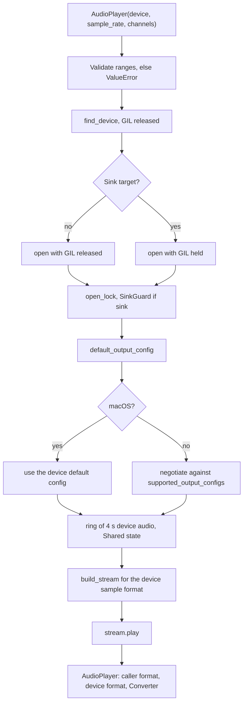

# Stream Setup and Config Negotiation

Creating an `AudioPlayer` opens and starts a real output stream. This page
follows `AudioPlayer::new` and `AudioPlayer::open` in `src/player.rs` from
arguments to a running callback. Two formats run through it and must not be
confused:

- the **caller format** — `sample_rate` × `channels`, what `write()` expects;
- the **device format** — `device_sample_rate` × `device_channels` plus a
  device sample type, what the stream actually runs at.

## Sequence



1. **Validate.** `sample_rate`, if given, must be within 1 000–768 000 Hz and
   `channels` within 1–64; otherwise `ValueError` is raised before any device
   work. (Zero values used to panic deep in the resampler.)
2. **Find the device** with the GIL released
   ([Device Discovery and Selection](../devices/device-discovery-and-selection.md)).
3. **Open.** For a direct device the whole open runs with the GIL released;
   for a PipeWire/PulseAudio sink it runs with the GIL held, because the sink
   is selected through a process-global environment variable
   ([Sink Routing](../devices/pipewire-sink-routing.md)). Either way `open()`
   holds the global open lock and applies the sink override for its whole
   duration.
4. **Defaults.** `default_output_config()` is queried; an unspecified
   `sample_rate` or `channels` takes the default's value. Together they form
   the caller format.
5. **Choose the device config** (next section).
6. **Allocate.** The ring holds `device_rate × device_channels × 4` f32
   samples — four seconds of device audio (≈1.5 MB at 48 kHz stereo). A fresh
   `Shared` holds the counters and flags.
7. **Build** the output stream for the device's sample format and **start**
   it with `play()`.
8. **Record** the caller format as `sample_rate`/`channels`, the chosen config
   as `device_sample_rate`/`device_channels`, and create the `Writer` with a
   `Converter` from caller to device format
   ([Resampling and Channel Mapping](resampling-and-channel-mapping.md)).

The callback starts immediately and renders silence until the first
`write()`; the device stays held until `stop()` or until the player is
garbage-collected. The stream config comes straight from the chosen
`SupportedStreamConfig` via `config()`, so pyaudiocast never asks for a
specific buffer size — the backend's default applies.

## `negotiate()`: picking the device config

Off macOS, the device's supported config ranges are listed and
`negotiate(supported, default, rate, channels)` picks, in order:

1. a range with the **caller's channel count** that contains the **caller's
   rate**;
2. otherwise a range with the **device default's channel count** that contains
   the caller's rate;
3. otherwise the **device default config** unchanged.

DSD formats are never chosen. Among several matching ranges, cpal's
`cmp_default_heuristics` decides — in practice it ranks sample formats with
`f32` first. The chosen range is pinned to the caller's rate with
`with_sample_rate`.

The order encodes two preferences:

- **Keep the caller's rate** whenever the device can take it, so no
  resampling happens in Rust.
- **Keep the caller's channel count** when possible, so the system mixer
  (PulseAudio/PipeWire behind the `pulse` device, for instance) converts
  channels instead of pyaudiocast's simple positional remap.

The unit test `negotiate_prefers_user_config_then_default` shows each branch.
With supported ranges `2ch i16 8–192 kHz`, `2ch f32 44.1–48 kHz`,
`2ch i32 48 kHz`, `1ch f32 16 kHz`, and a default of `2ch 48 kHz i32`:

| Caller format | Chosen device format | Why | Converter work |
|---|---|---|---|
| 16 kHz mono | 16 kHz, 1 ch, f32 | caller rate and channels supported | none |
| 22.05 kHz mono | 22.05 kHz, 2 ch, i16 | no mono range at 22.05 kHz; default channel count at the caller's rate | mono → stereo remap |
| 44.1 kHz stereo | 44.1 kHz, 2 ch, f32 | two ranges match; f32 preferred over i16 | none |
| 7 kHz mono | 48 kHz, 2 ch, i32 | nothing supports 7 kHz | resample 7 → 48 kHz, mono → stereo |

## The macOS exception

On macOS the stream always opens at the device's **current default** config
and `negotiate()` is skipped. CoreAudio applies a stream's format to the
hardware, so opening at the caller's rate would switch the output device's
rate for every application. Instead the converter adapts the caller's audio;
cpal may still switch the hardware's sample format to 32-bit float. (This
became the behavior in 0.2.0.)

## Sample-format dispatch

`build_stream::<T>` is generic over the device sample type; `open()` matches
on the chosen format and instantiates it for `f32`, `f64`, `i8`, `i16`,
`I24`, `i32`, `i64`, `u8`, `u16`, `U24`, `u32` or `u64`. Any other format
fails with `Config error: <host:id>: Unsupported sample format: <format>`.
Conversion from the ring's f32 samples into `T` happens in the callback
([Audio Callback and Rendering](audio-callback-and-rendering.md#sample-format-conversion)).

## Errors

Every cpal call in `open()` — the default config, the supported ranges,
building and starting the stream — maps its error through
`SpeakerError::from` and `context(&id)`, where `id` is the device's
`host:id`. cpal's `UnsupportedConfig` and `InvalidInput` become
`Config error: <host:id>: …`; everything else becomes
`Stream error: <host:id>: …`. Both reach Python as `RuntimeError`
([Native Extension Boundary](../architecture/native-extension-boundary.md#errors-crossing-the-boundary)).

## Observing the result

```python
with pyaudiocast.AudioPlayer(sample_rate=44100, channels=1) as player:
    print(player.sample_rate, player.channels)                # 44100 1  (caller format)
    print(player.device_sample_rate, player.device_channels)  # e.g. 44100 1, or 48000 2
```

`PYAUDIOCAST_LOG=info` also logs
`Config: user=<rate>Hz <ch>ch, device=<rate>Hz <ch>ch <sample format>`.
`examples/play_sine.py` prints both formats.

## Tests

| Test | Covers |
|---|---|
| `negotiate_prefers_user_config_then_default` (Rust) | The fallback chain and format preference above |
| `TestAudioPlayerInit::test_create_auto_detect` | Defaults come from the device; `is_active` before and after `stop()` |
| `TestAudioPlayerInit::test_create_partial_override_sample_rate` | Overriding only `sample_rate` keeps it as the caller format |
| `TestAudioPlayerInit::test_invalid_config_raises_value_error` | `sample_rate=0` / `channels=0` raise `ValueError` |
| `TestAudioPlayerInit::test_create_nonexistent_device_raises` | Lookup failure surfaces as `RuntimeError("Device not found…")` |

## Related pages

- [Device Discovery and Selection](../devices/device-discovery-and-selection.md)
- [PipeWire/PulseAudio Sink Routing](../devices/pipewire-sink-routing.md)
- [Resampling and Channel Mapping](resampling-and-channel-mapping.md)
- [Audio Callback and Rendering](audio-callback-and-rendering.md)
- [Python API Reference](../api/python-api.md)
