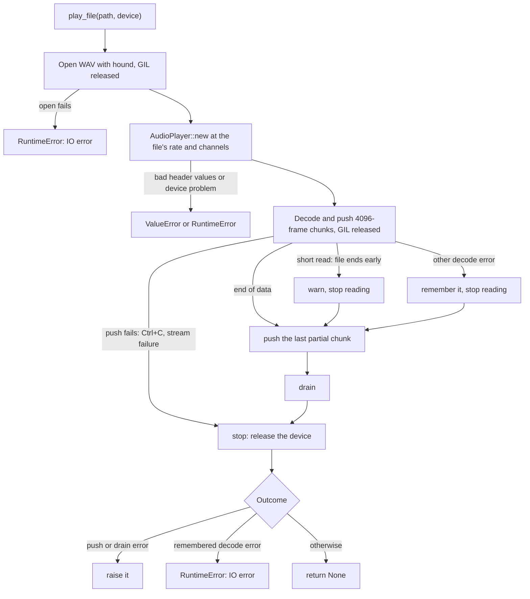

# WAV File Playback (`play_file`)

`pyaudiocast.play_file(path, device=None)` is a blocking, one-shot wrapper
around the playback engine, implemented in `src/lib.rs`. It does not go
through Python objects internally: it builds a Rust `AudioPlayer` and feeds it
directly with decoded samples.

## Flow

1. **Open off the GIL.** `hound::WavReader::open` runs inside `py.detach`,
   because opening a FIFO blocks until a writer shows up. `path` can be a
   `str` or any `os.PathLike`. Failures (missing file, not a WAV, unsupported
   encoding) raise `RuntimeError: IO error: …` immediately, before any device
   is touched.
2. **Create the player** with the regular constructor,
   `AudioPlayer::new(py, device, Some(spec.sample_rate), Some(spec.channels))`.
   The file's format becomes the caller format, so all of
   [Stream Setup](stream-setup-and-negotiation.md) applies: header values
   outside 1–768 kHz or 1–64 channels raise `ValueError`, device lookup and
   negotiation work as for `AudioPlayer`, and the audio is converted for the
   device if needed.
3. **Stream the samples** (GIL released). Samples are decoded one at a time
   into a buffer of 4096 frames (`4096 × channels` samples); each full buffer
   is pushed into the player, blocking while the ring is full. Memory use
   stays bounded by the buffer plus the player's 4-second ring, whatever the
   file length.
   - **Integer PCM** is read as `i32` and scaled by `2^-(bits−1)`, then capped
     at `MAX_SAMPLE` (for 32-bit files `i32::MAX × 2^-31` rounds to 1.0 in f32,
     which 24-bit output would wrap).
   - **Float** samples go through `sanitize`: clamped to −1.0..`MAX_SAMPLE`,
     NaN/inf replaced with silence.
4. **Push the remainder.** After the loop, the partly filled buffer is pushed.
   If the file ended mid-frame, that trailing partial frame stays in the
   writer and is never played.
5. **Drain** — only if decoding and pushing succeeded — so the call returns
   after the last sample is audible.
6. **Stop**, always, releasing the device whatever happened before.
7. **Report**: a push/drain error first, else a remembered decode error, else
   success (`Playback finished` at info level).

## Files shorter than their header

A WAV header declares the size of its data. Two kinds of real-world files
declare more than they contain:

- **truncated files** (cut off, possibly mid-sample);
- **files written through a pipe** — a tool like sox cannot seek back to fill
  in the size, so it declares a huge placeholder (~2 GB).

hound reports reading past the end as an I/O error of kind `Other` ("Failed
to read enough bytes"), which an operating system never produces, or
`UnexpectedEof`. `is_short_read()` recognizes both, and `play_file` treats
them as the end of the file: it logs
`play_file: file ends before its declared length` at warn level and plays
everything that was there. (Before 0.2.0 this raised after playing.)

## Error ordering

| When it happens | What plays | What is raised |
|---|---|---|
| Opening the file fails | nothing | `RuntimeError: IO error: …` |
| Header rate/channels out of range | nothing | `ValueError` |
| Device not found / cannot be opened | nothing | `RuntimeError` (`Device not found: …`, `Config error: …`, `Stream error: …`) |
| Data ends before the declared length | everything present | nothing (warning logged) |
| Decode error mid-file | everything decoded before the error, played to the end | `RuntimeError: IO error: …` after playback and device release |
| Ctrl+C while pushing or draining | what was already audible; the queue is discarded by `stop()` | `KeyboardInterrupt` |
| Device fails or stalls while pushing or draining | up to the failure | `RuntimeError: Stream error: …` |

Ctrl+C works because the push loop and `drain()` run Python signal handlers
every 100 ms while they wait
([Blocking Waits](blocking-waits-and-stream-failures.md)). If a push or drain
error and a decode error both occur, the push/drain error is the one raised.

## Why a fixed epoch is safe

`play_file` pushes every chunk with epoch `0`. The internal player was created
by this call (so its epoch starts at 0) and is never exposed to Python, so no
`clear()` can ever change it; the only way playback ends early is an error or
a signal. See [Interruption, Drain and Stop Semantics](interruption-and-drain.md)
for what the epoch does in a public player.

## Tests

| Test | Covers |
|---|---|
| `TestPlayFile::test_play_nonexistent_file_raises` | Missing file → `RuntimeError` (no audio device needed) |
| `TestPlayFile::test_play_file_accepts_pathlike` | A `pathlib.Path` to a 0.2 s, 22.05 kHz mono file plays for at least 0.15 s |
| `TestPlayFile::test_play_file_shorter_than_its_header[truncated]` | File cut 2001 bytes short (mid-sample) plays without raising |
| `TestPlayFile::test_play_file_shorter_than_its_header[pipe_header]` | Data chunk size patched to `0x7FFFF000`, as sox writes to a pipe, plays without raising |
| `lib.rs::a_truncated_wav_reads_as_short` (Rust) | hound's error for a truncated file is classified as a short read |

`examples/play_wav.py` is a minimal command-line player built on `play_file`.

## Related pages

- [Python API Reference](../api/python-api.md)
- [Stream Setup and Config Negotiation](stream-setup-and-negotiation.md)
- [Write Path and Input Formats](write-path-and-input-formats.md)
- [Interruption, Drain and Stop Semantics](interruption-and-drain.md)
